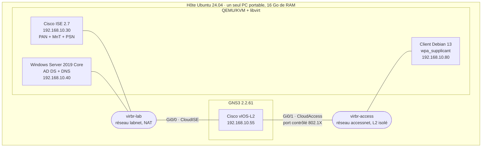
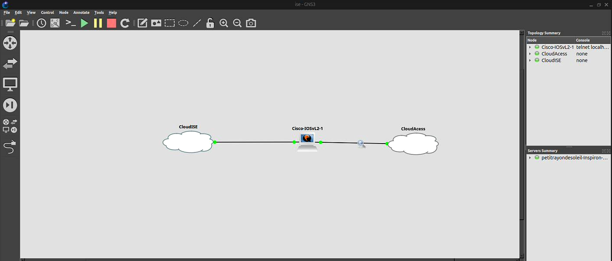
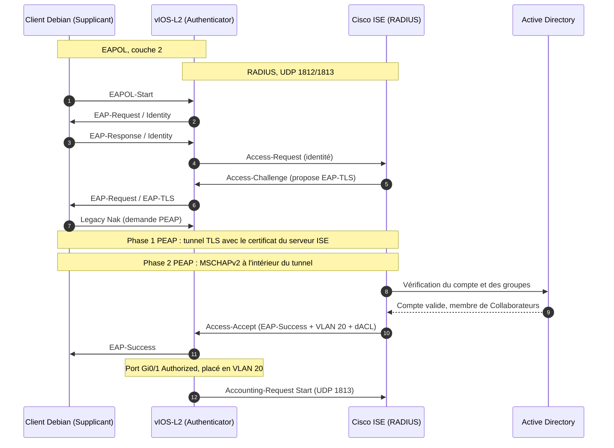
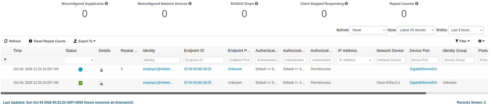
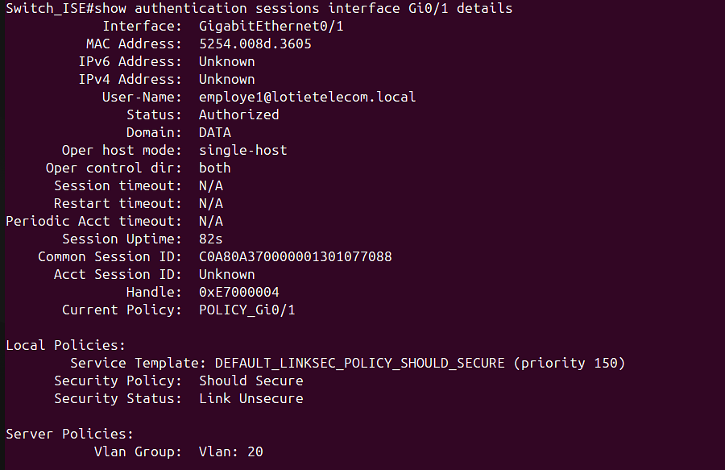
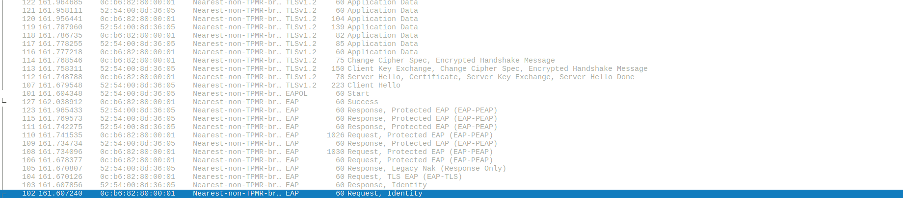
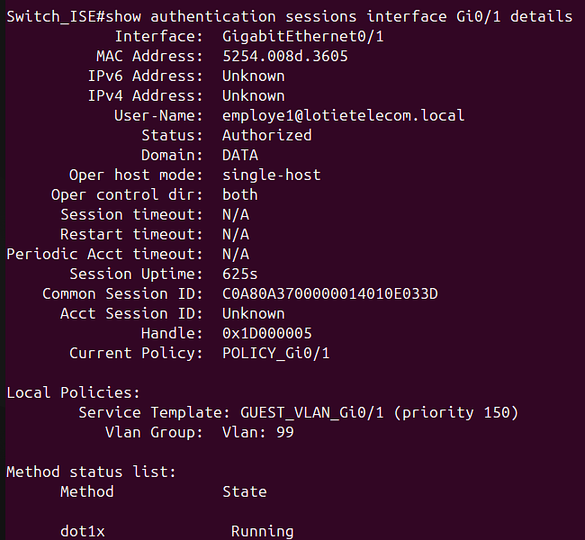
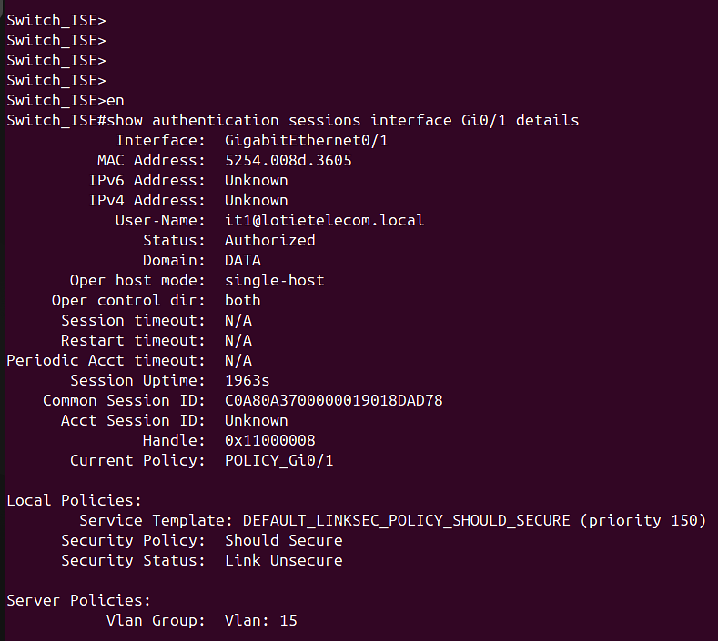
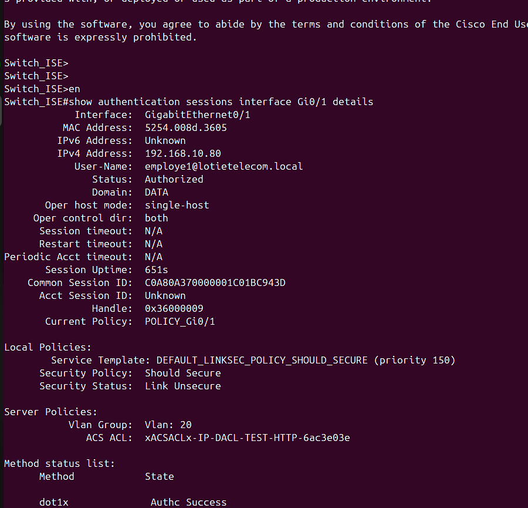

# Contrôle d'accès réseau (NAC) avec IEEE 802.1X et Cisco ISE


Laboratoire complet de contrôle d'accès réseau, monté sur **un seul PC portable** (Ubuntu, 16 Go de RAM) : un poste ne peut accéder au réseau qu'après s'être authentifié, et le VLAN qu'il reçoit dépend du groupe Active Directory de son utilisateur.

Projet de fin d'études (Licence professionnelle Sécurité informatique, Cybersécurité et Cybercriminalité, ESA Lomé), réalisé pendant mon stage chez Lotié Télécom.

> **In English:** a fully virtualized NAC lab (KVM + GNS3) where a Debian client authenticates with 802.1X (PEAP-MSCHAPv2) through a Cisco vIOS-L2 switch to Cisco ISE 2.7, backed by Active Directory. Valid users land in a VLAN chosen from their AD group, failed attempts are pushed to a quarantine VLAN, and every session is logged in ISE.

---

## Sommaire

- [Le problème](#le-problème)
- [Ce que fait le labo](#ce-que-fait-le-labo)
- [Architecture](#architecture)
- [Déroulement d'une authentification](#déroulement-dune-authentification)
- [Résultats des tests](#résultats-des-tests)
- [Contenu du dépôt](#contenu-du-dépôt)
- [Reproduire le labo](#reproduire-le-labo)
- [Problèmes rencontrés et solutions](#problèmes-rencontrés-et-solutions)
- [Limites et pistes d'amélioration](#limites-et-pistes-damélioration)
- [Références](#références)

---

## Le problème

Dans beaucoup de petites entreprises, le réseau local fait confiance à tout ce qui s'y branche : un câble sur une prise libre suffit pour obtenir une adresse IP et atteindre les postes de travail. Aucune vérification d'identité, aucune séparation entre les usages, aucune trace de qui s'est connecté.

L'objectif de ce projet : **vérifier l'identité de chaque utilisateur avant d'ouvrir le port du switch, puis lui donner uniquement les droits qui correspondent à son rôle.**

## Ce que fait le labo

| Fonction | Mécanisme |
|---|---|
| Authentifier avant d'ouvrir le port | IEEE 802.1X, EAP **PEAP-MSCHAPv2**, RADIUS |
| Utiliser les comptes de l'entreprise | Cisco ISE joint à un domaine **Active Directory** |
| Donner un VLAN selon le rôle | **VLAN dynamique** (attributs RADIUS Tunnel-*) selon le groupe AD |
| Isoler les échecs | Repli local du switch vers le **VLAN 99** (quarantaine) |
| Filtrer les flux d'une session | **dACL** téléchargée depuis ISE |
| Savoir qui s'est connecté | **Live Logs** et rapports de Cisco ISE |

Plan de segmentation :

| VLAN | Nom | Attribué à |
|---|---|---|
| 10 | ADMIN | Groupe Administration (prévu, non testé) |
| 15 | IT | Groupe AD `IT` |
| 20 | COLLABORATEURS | Groupe AD `Collaborateurs` |
| 99 | INVITE | Échec d'authentification ou absence de réponse |

## Architecture

Tout tourne sur le même PC : les machines virtuelles sous QEMU/KVM, le switch sous GNS3, reliés par deux ponts Linux. Le client n'a **aucun autre chemin** vers le réseau que le port Gi0/1 du switch.



| Composant | Version | Ressources | Rôle 802.1X |
|---|---|---|---|
| Cisco ISE | 2.7.0.356 (nœud unique) | 4 vCPU, **10 Go RAM**, 107 Go | Serveur d'authentification (RADIUS) |
| Windows Server | 2019 Core | 2 Go RAM, 40 Go | Annuaire Active Directory + DNS |
| Cisco vIOS-L2 | IOS 15.2 | 512 Mo RAM | Authenticator |
| Debian | 13, sans interface graphique | 1 vCPU, 1 Go RAM | Supplicant (wpa_supplicant) |
| Hôte | Ubuntu 24.04, Dell Inspiron 15 3520 | 16 Go RAM | QEMU/KVM, libvirt, GNS3, Wireshark |



## Déroulement d'une authentification



Le VLAN est transmis dans l'Access-Accept par trois attributs normalisés (RFC 3580) : `Tunnel-Type = 13 (VLAN)`, `Tunnel-Medium-Type = 6 (802)` et `Tunnel-Private-Group-ID = 20`.

## Résultats des tests

Un scénario n'est validé que si **plusieurs sources indépendantes** (client, switch, ISE, Wireshark) donnent le même résultat.

| # | Scénario | Résultat | Sources concordantes |
|---|---|---|---|
| S1 | Compte AD valide (`employe1`) | ✅ Port `Authorized`, VLAN 20 | Client, ISE, switch, Wireshark |
| S2 | Mot de passe erroné | ✅ `Access-Reject` (erreur MSCHAPv2 691), port en VLAN 99 | Client, ISE, switch |
| S3 | Deux groupes AD différents | ✅ `employe1` → VLAN 20, `it1` → VLAN 15 | Client, ISE, switch |
| S4 | Utilisateur soumis à une dACL | 🟡 Partiel : dACL téléchargée et appliquée à la session, effet sur un flux autorisé non vérifié | Switch, ISE |
| S5 | Traçabilité | ✅ Chaque session horodatée avec identité, MAC, switch et port | ISE |

<details>
<summary><b>S1 : authentification réussie (captures)</b></summary>

Live Logs de Cisco ISE :



Session sur le switch : port `Authorized`, VLAN 20 reçu d'ISE (`Server Policies`) :



Trames EAPOL dans Wireshark (EAP-TLS refusé, passage à PEAP, tunnel TLS, EAP-Success) :



</details>

<details>
<summary><b>S2 : mauvais mot de passe, repli en VLAN 99</b></summary>

Le port affiche `Authorized`, mais c'est la politique de repli **locale** du switch (`Local Policies`, `GUEST_VLAN_Gi0/1`), pas une authentification réussie :



</details>

<details>
<summary><b>S3 : VLAN différent selon le groupe AD</b></summary>

Le compte `it1`, membre du groupe IT, reçoit le VLAN 15 :



</details>

<details>
<summary><b>S4 : dACL appliquée à la session</b></summary>

Ligne `ACS ACL` dans la session du switch, en plus du VLAN 20 :



</details>

## Contenu du dépôt

```text
.
├── README.md
├── LICENSE
├── configs/
│   ├── switch/vios-l2-dot1x.cfg          # AAA, RADIUS, VLAN, port 802.1X
│   ├── supplicant/                       # profils wpa_supplicant (exemples)
│   │   ├── wired.conf.example            # employe1, bon mot de passe
│   │   ├── it1.conf.example              # it1 (groupe IT)
│   │   └── mauvais.conf.example          # mot de passe volontairement faux
│   ├── libvirt/labnet.xml                # réseau d'infrastructure (NAT)
│   ├── libvirt/accessnet.xml             # réseau d'accès L2 isolé
│   ├── ise/README.md                     # configuration de Cisco ISE pas à pas
│   ├── ise/DACL-TEST-HTTP.txt            # contenu de la dACL
│   └── ad/setup-lab.ps1                  # domaine, comptes, groupes, heure
├── scripts/
│   ├── fix-eapol-bridge.sh               # laisse passer EAPOL sur le pont Linux
│   └── demo.sh                           # démo sans saisie (ok / ko / it)
└── docs/images/                          # captures des résultats
```

Les images Cisco (ISE, vIOS-L2) et Windows Server ne sont pas fournies : ce sont des logiciels propriétaires.

## Reproduire le labo

<details>
<summary><b>1. Réseaux virtuels sur l'hôte</b></summary>

```bash
sudo virsh net-define configs/libvirt/labnet.xml
sudo virsh net-define configs/libvirt/accessnet.xml
for n in labnet accessnet; do sudo virsh net-start $n; sudo virsh net-autostart $n; done

# Indispensable : sans ça, le pont Linux bloque les trames EAPOL
./scripts/fix-eapol-bridge.sh
```

</details>

<details>
<summary><b>2. Machines virtuelles</b></summary>

- **Cisco ISE 2.7** sur `labnet` : 4 vCPU, 10 Go de RAM. Déclarer le produit `KVM` dans la section `sysinfo` (SMBIOS) de la VM, sinon ISE refuse la plateforme. Adresse 192.168.10.30.
- **Windows Server 2019 Core** sur `labnet` : 2 Go de RAM, adresse 192.168.10.40, puis `configs/ad/setup-lab.ps1`.
- **Client Debian 13** sur **`accessnet`** (et pas `labnet` !) : 1 vCPU, 1 Go, installation minimale, `apt install wpasupplicant`.

</details>

<details>
<summary><b>3. Switch vIOS-L2 sous GNS3</b></summary>

- Nœud `CloudISE` relié à `virbr-lab` sur Gi0/0, nœud `CloudAccess` relié à `virbr-access` sur Gi0/1.
- Appliquer `configs/switch/vios-l2-dot1x.cfg` en remplaçant `<CLE_RADIUS>`.
- Vérifier le lien RADIUS **avant** d'activer 802.1X : `test aaa group radius <utilisateur> <mot_de_passe> new-code`.

</details>

<details>
<summary><b>4. Cisco ISE</b></summary>

Voir [`configs/ise/README.md`](configs/ise/README.md) : déclaration du switch, jonction au domaine, profils d'autorisation, règles et dACL.

</details>

<details>
<summary><b>5. Test côté client</b></summary>

```bash
sudo cp configs/supplicant/wired.conf.example /etc/wpa_supplicant/wired.conf   # puis mettre le vrai mot de passe
sudo wpa_supplicant -i ens1 -c /etc/wpa_supplicant/wired.conf -D wired
# Succès attendu : CTRL-EVENT-EAP-SUCCESS puis CTRL-EVENT-CONNECTED
```

Côté switch :

```text
show authentication sessions interface Gi0/1 details
```

</details>

## Problèmes rencontrés et solutions

C'est la partie qui m'a le plus appris. Tous ces blocages ont vraiment eu lieu pendant le projet.

| Symptôme | Cause | Solution |
|---|---|---|
| Le pontage réseau ne fonctionne pas sous VMware Workstation | Bridging VMware défaillant sur l'hôte Ubuntu | Passage à QEMU/KVM + libvirt, intégré au noyau Linux |
| vIOS-L2 sous `virsh` : une seule interface, `No more available PCI slots` | L'image n'expose qu'une interface sous KVM seul | Switch déplacé sous GNS3 (8 interfaces) |
| Aucune authentification, alors que le switch semble bien configuré | VM cliente branchée sur `labnet` au lieu d'`accessnet` : ses trames ne passaient jamais par Gi0/1 | Rattacher la carte réseau du client à `accessnet` |
| Le switch ne reçoit aucune trame EAPOL | Un pont Linux ne relaie pas l'adresse réservée `01:80:C2:00:00:03` | `group_fwd_mask = 8` sur `virbr-access`, **à refaire après chaque redémarrage** |
| `unknown global field` au lancement de wpa_supplicant | `fast_reauth=0` placé hors du bloc `network={}` | Déplacer la ligne dans le bloc |
| Écran noir après la promotion de Windows Server en contrôleur de domaine | Blocage de la VM au redémarrage | VM supprimée et réinstallée, la deuxième promotion a réussi |
| ISE n'arrive pas à rejoindre le domaine | DNS `8.8.8.8` resté sur ISE depuis l'installation, les enregistrements SRV du domaine ne sont pas résolus | DNS d'ISE pointé vers l'AD (192.168.10.40) |
| Les authentifications AD échouent après avoir marché, jonction repassée en `Not Joined`, erreur `LW_ERROR_CLOCK_SKEW` (40087) | Fuseau de l'AD resté sur *Romance Standard Time* (UTC+1) + dérive de l'horloge de la VM : Kerberos refuse l'écart | `Set-TimeZone -Id "Greenwich Standard Time"` puis `Set-Date` sur l'heure d'ISE |
| Plus rien dans les Live Logs, même pas un échec | `wpa_supplicant` ne tournait plus côté client et la session du switch était figée | `shutdown` / `no shutdown` sur Gi0/1 puis relancer wpa_supplicant |
| Le port affiche `Authorized` avec un mauvais mot de passe | Normal : c'est le repli local vers le VLAN 99 | Lire `Local Policies` vs `Server Policies` dans la sortie du switch |

À retenir aussi : sans `aaa authorization network default group radius`, le switch **ignore** le VLAN et la dACL envoyés par ISE, même si l'authentification réussit.

## Limites et pistes d'amélioration

- **Certificat du serveur non vérifié** : les profils wpa_supplicant n'ont pas de `ca_cert`. Hors labo, il faut l'ajouter, sinon PEAP reste exposé à un faux serveur RADIUS.
- **Échelle** : un seul switch et un seul poste client, pas de test de charge.
- **Images d'évaluation** : ISE 2.7 n'est plus supporté par Cisco, vIOS-L2 est une image expérimentale.
- **dACL** : téléchargée et appliquée, mais l'effet sur un flux autorisé reste à vérifier (vIOS-L2 n'affiche pas de compteurs pour ces listes).
- **Pistes** : EAP-TLS avec une PKI, extension au Wi-Fi en WPA2-Entreprise, MAB et profilage pour les imprimantes et objets connectés, posture et TrustSec pour aller vers le Zero Trust.

## Références

- IEEE Std 802.1X-2020, *Port-Based Network Access Control*
- RFC 2865 (RADIUS), RFC 2866 (RADIUS Accounting), RFC 3748 (EAP), RFC 5216 (EAP-TLS), RFC 3580 (802.1X et RADIUS)
- NIST SP 800-207, *Zero Trust Architecture*
- Cisco, *Cisco Identity Services Engine Administrator Guide, Release 2.7*
- [libvirt, Network XML format](https://libvirt.org/formatnetwork.html) · [GNS3 Documentation](https://docs.gns3.com) · [wpa_supplicant](https://w1.fi/wpa_supplicant/)

---

**Justine Nutsule** · Licence professionnelle Sécurité informatique, Cybersécurité et Cybercriminalité · ESA Lomé, 2023-2026

<!-- Ajoute ici ton lien LinkedIn ou ton portfolio, par exemple : [LinkedIn](https://www.linkedin.com/in/ton-profil) -->

*Projet réalisé en laboratoire, à des fins pédagogiques. Les mots de passe et la clé RADIUS ont été remplacés par des valeurs d'exemple.*
